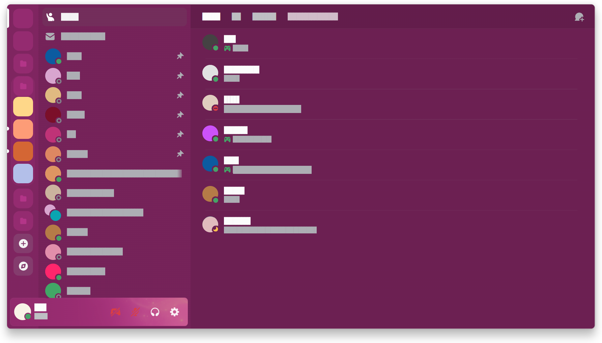
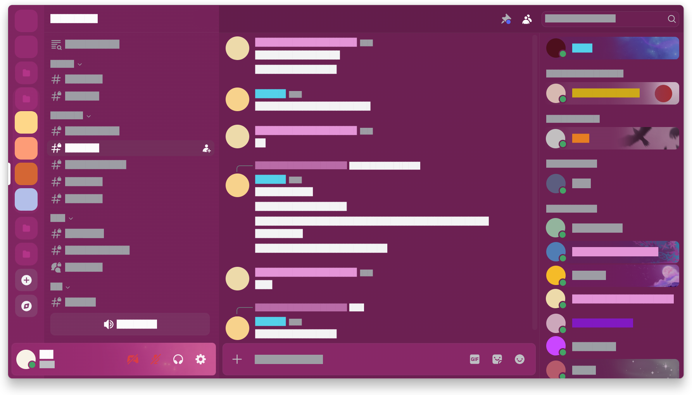

# Disclutter Theme

<table>
  <tr>
    <td></td>
    <td></td>
  </tr>
</table>

A lightweight, clutter-free theme for **Discord mod clients** designed to strip away visual noise and keep the interface clean. **Not a traditional color theme.** Disclutter does not change Discord's colors, fonts or overall design - it strictly hides unnecessary UI elements and adjusts spacing.

*The solid blocks and bars shown in the preview screenshot are only used for data privacy, not part of the theme.*

## Features

* **Clutter-Free Navigation:** Hides promotional elements and redundant section headers or separators.
* **Clean Chat & Messages:** Removes clan tags, Gift and Apps buttons, and improves readability.
* **Minimal Tabs & Profiles:** Declutters friend lists, profile badges, mutuals and unnecessary action buttons.
* **Compact Window Layout:** Removes the top title bar and adjusts margins and folders for a tighter UI.

## Recommended Setup

For the best experience, enable **Compact** layout mode:
1. Open **User Settings** in Discord.
2. Go to **Interaction** > **Accessibility**.
3. Set **Interface Density** to **Compact**.

## Installation

Make sure you have **Discord mod client** installed, then:
1. Download the CSS file from this repository.
2. Navigate to the **Themes** tab in your settings.
3. Place the `.css` file into your themes folder.
4. Click the **Refresh** button and enable **Disclutter**.

## Customization

You can tweak the layout by editing the CSS variables inside the `:root` block at the top of the file:

* **Restore full message width:** Comment out `--message-width`.
* **Adjust spacing & density:** Modify other top variables as needed.

## License

Copyright (c) 2026 b3hav1

This repository is licensed under the [MIT License](LICENSE).
